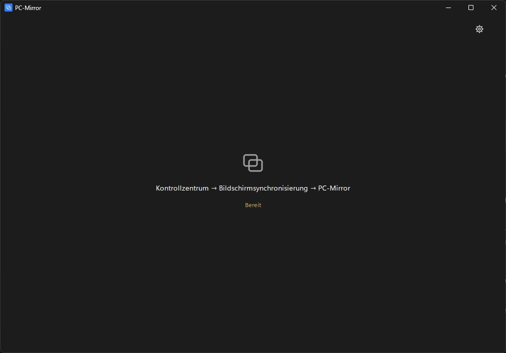

# PC-Mirror

Native Windows-App für iPhone- und iPad-Bildschirmsynchronisierung mit Ton. App und AirPlay-Empfänger sind in **Rust** geschrieben (Oberfläche mit [Slint](https://slint.dev), Empfänger ab **0.4.0**); Video und Ton gibt die mitgelieferte GStreamer-Runtime aus. Der frühere C-Empfänger (UxPlay) liegt als Ausweichlösung bei. Keine Webseite, kein Browser-Frontend, kein Qt mehr.



## Installation und Nutzung

1. `PCMirror-win-Setup.exe` von [pcmirror.oel.best](https://pcmirror.oel.best/PCMirror-win-Setup.exe) starten. Ziel: Windows 10 ab Build 19041 oder Windows 11, x64. Empfänger, GStreamer und Codecs sind enthalten; kein Bonjour, kein .NET, keine VC++-Runtime nötig. Bestehende Installationen ab 0.2.5 aktualisieren sich automatisch.
2. PC und iPhone/iPad am selben Router betreiben. Ethernet am PC ist erlaubt. Kein isoliertes Gastnetz; VPN kann die Erkennung blockieren. Im vertrauenswürdigen Heimnetz das Windows-Netzwerkprofil **Privat** wählen.
3. Bei Firewall-Hinweis **Firewall einrichten** wählen. Windows fragt nach Administratorrechten. Ist das Netz als „Öffentlich“ eingestuft, bietet die App **Netzwerk freigeben** an (stuft es nach Rückfrage als privat ein).
4. iPhone → Kontrollzentrum → **Bildschirmsynchronisierung** → **PC-Mirror**.

Beim Spiegeln füllt das Bild die Anzeige ohne Verzerrung. Die schmale Leiste mit Vollbild, Screenshot, Ton und Trennen erscheint bei Mausbewegung und verschwindet nach etwa 2,6 Sekunden.

| Funktion | Bedienung |
|---|---|
| Vollbild | F11, Doppelklick aufs Bild oder Leiste; Escape beendet Vollbild |
| Screenshot | Kamera-Symbol, PNG-Ziel wählen; gespeichert wird nur der empfangene Videoframe |
| Ton | Lautsprecher-Symbol; nur diese App wird stummgeschaltet |
| Trennen | Stopp-Symbol; der Empfänger wird neu bereitgestellt |
| Einstellungen | Zahnrad im Wartebildschirm oder Strg+, |
| iPad: Fenster ausfüllen | Einstellungen; nur bei erkannten iPads, schneidet Ränder mittig ab |
| Sprache, Qualität, PIN, Vordergrund, Autostart, Updates | Einstellungen |

Qualität: 720p/30, 1080p/60 oder experimentell 4K/H.265/60; die tatsächliche Auflösung bestimmt das Gerät. Die PIN kann fest (0001–9999) oder leer für einen zufälligen Code sein; sie wird per Windows-DPAPI verschlüsselt gespeichert. Nur Änderungen an Name, Qualität, PIN oder Decodierung starten den Empfänger neu – Sprache, Vordergrund, Autostart, Updates und iPad-Darstellung trennen die Spiegelung nicht.

## Netzwerk und Firewall

Der Empfänger kündigt `_airplay._tcp` und `_raop._tcp` über seinen eingebauten mDNS-Responder auf allen echten Netzwerkadaptern an (VPN-Adapter wie Radmin oder Hamachi ausgenommen). Ports: **TCP/UDP 48000–48002** und **UDP 5353**. Die Regeln gelten nur für die mitgelieferten Empfänger (`uxplay.exe`, `uxplay-classic.exe`), Profil **Privat**, Gegenstelle **LocalSubnet**. Die Prüfung erkennt auch Freigaben aus dem Windows-Dialog und Block-Regeln; nach einer erfolgreichen Verbindung erscheint kein Firewall-Hinweis mehr. Programmpfad: `%LOCALAPPDATA%\PCMirror\current` (bleibt bei Updates gleich).

## Automatische Updates

Prüfung nach dem Start und alle sechs Stunden (abschaltbar), manuell über **Nach Updates suchen**. „Jetzt installieren“ lädt das Paket; während einer Spiegelung wird die Installation bis zum Sitzungsende zurückgestellt, „Später“ widerruft sie. Automatische Prüfungen ohne Internet bleiben still, manuelle zeigen einen Hinweis.

Sicherheit: Der Update-Feed `releases.win.json` ist mit einem **Ed25519-Schlüssel signiert** (`releases.win.json.sig`). Die App enthält nur den öffentlichen Schlüssel (`packaging/update-signing.pub`) und lehnt unsignierte oder veränderte Feeds ab. Velopack prüft danach jedes Paket gegen den SHA-256 aus dem signierten Feed. Ein übernommener Webserver kann damit keine eigenen Pakete ausliefern. Details: [docs/UPDATES.md](docs/UPDATES.md).

## Aufbau

| Teil | Ort |
|---|---|
| App (Rust, Slint) | `crates/pcmirror` – Oberfläche `ui/app.slint`, Logik `src/` |
| Signaturwerkzeug | `crates/pcmirror-sign` (`keygen`, `sign`, `verify`) |
| AirPlay-Empfänger (Rust) | `crates/pcmirror-receiver` – Protokoll, Pairing, FairPlay, Video/Ton |
| Klassischer Empfänger | `third_party/uxplay` (C/C++, modifiziertes UxPlay 1.74, Ausweichlösung) |
| Build/Release | `scripts/` |
| Tests | `cargo test`, `tests/` |

Architektur: [docs/ARCHITECTURE.md](docs/ARCHITECTURE.md).

## Build

Voraussetzungen: Windows x64, [Rust](https://rustup.rs) (MSVC-Toolchain mit Visual Studio Build Tools), Python 3.10+.

```powershell
cargo test --workspace
cargo build --release -p pcmirror
```

`target\release\PC-Mirror.exe` und `target\release\pcmirror-receiver.exe` (als `uxplay.exe`) neben eine vorhandene GStreamer-Runtime legen, um die App zu starten. Tests ohne iPhone: `python tests/airplay_e2e.py --package <Paket>` (nachgebauter Sender, siehe [Architektur](docs/ARCHITECTURE.md)). Für reine Layoutprüfung: `PC-Mirror.exe --ui-preview`; für Videoeinbettung ohne iPhone: `--test-pattern`.

Paket und Installer (lokal, ohne Upload):

```powershell
.\scripts\package.ps1 -PackageDirectory build\package -ReleaseDirectory dist\releases
```

Ohne MSYS2 wird die unveränderte Empfänger-Runtime aus `build\package-runtime` (oder `-RuntimeFrom <Ordner>`) übernommen. Soll der Empfänger selbst neu gebaut werden: [MSYS2](https://www.msys2.org/) UCRT64 installieren, dann im UCRT64-Terminal `bash scripts/install-build-deps.sh` und `bash scripts/build.sh`; `package.ps1` sammelt die Runtime dann aus MSYS2.

## Neue Version veröffentlichen

`version.txt` erhöhen und `.\scripts\release.ps1` starten. Das Skript testet, paketiert, prüft das Paket, **signiert den Feed** mit `.tools\signing\update-signing.key` und lädt alles per SFTP hoch (Feed und Signatur zuletzt). `-NoPublish` baut nur.

> Den privaten Signaturschlüssel `.tools\signing\update-signing.key` sicher aufbewahren (z. B. Passwortmanager). Ohne ihn können keine Updates mehr veröffentlicht werden, die installierte Versionen annehmen.

## Fehlerbehebung

**Nicht sichtbar:** gleiches Netz, Profil Privat, Firewall-Regeln, UDP 5353/Multicast prüfen; VPN, Gastnetz und AP-Isolation ausschließen. **Schwarzes Bild:** Home-Bildschirm testen; DRM-Inhalte können gesperrt sein; Software-Decodierung ausprobieren. **Kein Ton:** Windows-Ausgabe, Lautstärkemixer und Ton-Symbol prüfen. **Ruckeln:** 720p/30, PC per Ethernet, 5-/6-GHz-WLAN.

Logs: `%LOCALAPPDATA%\PC-Mirror\logs\pc-mirror.log` (rotiert ab 5 MiB), auch in **Diagnose** sichtbar. Einstellungen und `receiver.pem` liegen unter `%LOCALAPPDATA%\PC-Mirror` und bleiben bei Updates und Deinstallation erhalten.

## Lizenz und Quellen

Eigene App: **GPL-3.0-or-later**, [LICENSE](LICENSE). UxPlay und Änderungen liegen unter `third_party/uxplay`. Lizenzen der Rust-Bibliotheken liegen im Paket unter `licenses/Rust-Crates.txt`, die der GStreamer-Runtime unter `licenses/runtime`. Jeder Release enthält `PC-Mirror-VERSION-source.zip`; die unveränderten Runtime-Quellen stehen unter [PC-Mirror-0.2.1-runtime-sources.zip](https://pcmirror.oel.best/PC-Mirror-0.2.1-runtime-sources.zip).
