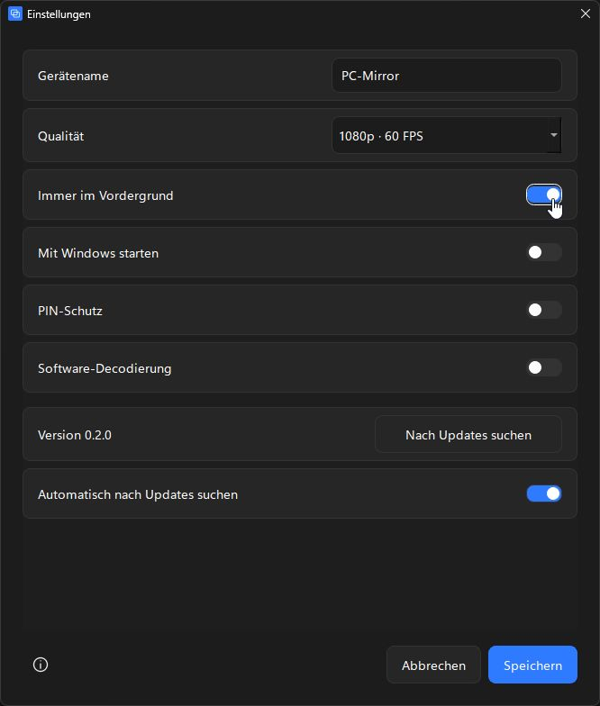

# PC-Mirror

Native Windows-App für iPhone-Bildschirmsynchronisierung mit Ton. Qt 6/C++, UxPlay und GStreamer; keine Webseite und kein Browser-Frontend.

Version **0.2.5**: Updates über **https://pcmirror.oel.best** und ein automatisierter Veröffentlichungsablauf. Native Updates mit **Velopack 1.2.161**; AirPlay-Handshake, Decodierung und Audioverarbeitung bleiben unverändert.




## Installation und Nutzung

1. Den neuen `dist/releases/PCMirror-win-Setup.exe` starten. Ziel: Windows 10 ab Build 19041 oder Windows 11, x64. Qt, UxPlay, GStreamer und benötigte Codecs sind enthalten. Kein separates Bonjour oder GStreamer installieren.
2. Bei Wechsel von Version 0.1.0 die alte Inno-Version zuerst schließen und in Windows deinstallieren. Der neue Velopack-Installer ist einmalig notwendig, damit spätere Updates automatisch funktionieren. Einstellungen unter `%LOCALAPPDATA%/PC-Mirror` bleiben erhalten.
3. PC und iPhone am selben Router betreiben. Ethernet am PC ist erlaubt. Kein isoliertes Gastnetz; VPN kann Discovery blockieren. Im vertrauenswürdigen Heimnetz Windows-Netzwerkprofil **Privat** wählen.
4. Bei Firewall-Hinweis unter **Einstellungen → Diagnose → Firewall einrichten** freigeben. Windows verlangt dafür Administratorrechte. Die App verändert das Netzwerkprofil nicht selbst.
5. iPhone → Kontrollzentrum → **Bildschirmsynchronisierung** → **PC-Mirror**.

Beim Spiegeln füllt das Bild die Anzeige ohne Verzerrung. Die schmale Leiste mit Vollbild, Screenshot, Ton und Trennen erscheint bei Mausbewegung und verschwindet nach etwa 2,6 Sekunden. Sie liegt über dem Bild und verändert seine Größe nicht.

| Funktion | Bedienung |
|---|---|
| Vollbild | F11, Doppelklick aufs Bild oder Leiste; Escape beendet Vollbild |
| Screenshot | Kamera-Symbol, PNG-Ziel wählen; nur der empfangene Videoframe wird gespeichert |
| Ton | Lautsprecher-Symbol; nur diese App wird stummgeschaltet |
| Trennen | Stopp-Symbol; Empfänger wird wieder bereitgestellt |
| Einstellungen | Zahnrad im Wartebildschirm oder Strg+, |
| iPad: Fenster ausfüllen | Einstellungen → Schalter; standardmäßig aus, gilt ausschließlich für erkannte iPads |
| Vordergrund, Autostart, Qualität, PIN | Einstellungsfenster |

**iPad-Darstellung (ab 0.2.4):** Standardmäßig wird das ganze Bild unverzerrt mit möglichen Balken angezeigt. „iPad: Fenster ausfüllen“ vergrößert das Bild proportional und beschneidet überstehende Ränder mittig. Dadurch können Bedienelemente am Bildrand fehlen. Die Einstellung wirkt sofort, auch bei Größenänderung und Drehung, ohne Neuverbindung. Während der Übertragung die Einstellungen mit **Strg+,** öffnen. iPhones und unbekannte Gerätemodelle bleiben bei der vollständigen Darstellung. Das Modell wird aus der AirPlay-Verbindung erkannt, nicht aus Bildschirmmaßen geraten. Screenshots speichern weiterhin das vollständige empfangene Bild.

Qualität: 720p/30, 1080p/60 oder experimentell 4K/H.265/60. Die tatsächliche Auflösung bestimmt das iPhone. Eine aktivierte PIN kann fest (0001–9999) oder leer für einen zufälligen Code sein. iOS kann bestehende Kopplungen speichern. Änderungen an den Empfängereinstellungen starten ihn neu; reine Update-/Vordergrund-/iPad-Darstellungseinstellungen trennen die Spiegelung nicht.

Das Design verwendet #1C1C1C, #262626 und #333333, weißen/sekundär grauen Text sowie Blau #2F7BFF für Hauptaktionen und aktive Zustände. Wartestatus gelb, verbunden grün, Fehler rot. Segoe UI Variable, drei Textgrößen, Linien-Icons, 8-px-Abstände und 8-px-Ecken. Native Windows-Titelleisten mit dunklem DWM-Stil und Mica-Unterstützung auf kompatiblen Windows-Versionen; keine eigenen Verläufe oder Glow-Effekte.

## Netzwerk, mDNS und Firewall

UxPlay verwendet seinen integrierten mDNS-Responder für `_airplay._tcp` und `_raop._tcp`. Ein externer Bonjour-Dienst ist nicht erforderlich. Feste Ports: **TCP/UDP 48000–48002**, **UDP 5353**. Regeln gelten nur für die konkrete `uxplay.exe`, Profil **Privat**, Gegenstelle **LocalSubnet**. Manche Protokollports öffnen sich erst beim Verbinden.

Neuer stabiler Programmpfad: `%LOCALAPPDATA%/PCMirror/current`. Firewall-Regeln für die frühere Installation müssen einmal für diesen neuen Pfad eingerichtet werden. Der Pfad bleibt bei weiteren Velopack-Updates gleich.

Alternativ in einer PowerShell **als Administrator** aus dem Programmordner:

```powershell
.\scripts\Configure-Firewall.ps1 -ReceiverPath "$PWD\uxplay.exe"
```

Zum Entfernen dieser Regeln vor dem Löschen der Datei `-Remove` ergänzen. Drittanbieter-Firewalls oder eigene ausgehende Sperrregeln separat prüfen. Windows kann das WLAN des iPhones nicht zuverlässig auslesen; die Diagnose zeigt lokale Adapter und erklärt die Netzbedingungen.

## Sprache

Unter **Einstellungen → Sprache** stehen **Deutsch** und **English** zur Auswahl. Die Oberfläche wechselt sofort, ohne die Spiegelung zu unterbrechen. **Speichern** merkt sich die Auswahl für spätere Starts; **Abbrechen** stellt die bisherige Sprache wieder her. Der Gerätename und technische Originalmeldungen im Log werden nicht übersetzt.

## Automatische Updates

Quelle ab 0.2.5: [pcmirror.oel.best](https://pcmirror.oel.best). Standardmäßig Prüfung nach dem Start und danach alle sechs Stunden. In den Einstellungen stehen aktuelle Version, **Nach Updates suchen** und **Automatisch nach Updates suchen**.

Bei einem Release erscheint eine dezente Leiste „Update verfügbar (vX.Y.Z)“ mit **Jetzt installieren** und **Später**. Ein Klick lädt und prüft das Paket, installiert es und startet neu. Beim laufenden Spiegeln wird die Installation bis zum Ende der Sitzung zurückgestellt; neue Videoframes brechen die Ruhefrist ab. „Später“ widerruft auch einen vorgemerkten Neustart. Checks ohne Internet bleiben still; die App läuft weiter. Details werden nur protokolliert.

Feed, Download, Integritätsprüfung und Installation übernimmt Velopack, kein eigener Updater. Die App verlangt einen gültigen SHA-256 im HTTPS-Feed; Velopack verifiziert die Datei vor Installation. Ein separater Helfer verhindert blockierende Netzwerkaufrufe im GUI-Thread.

## Neue Version veröffentlichen

`version.txt` erhöhen und in PowerShell `scripts/release.ps1` starten. Das Skript baut, testet, paketiert und veröffentlicht auf dem eigenen Server. Für kleine Update-Downloads werden Delta-Pakete erzeugt. Normale Veröffentlichungen brauchen weder Root-Passwort noch GitHub.

Einmalige Migration: 0.2.5 wird zusätzlich auf GitHub angeboten, damit ältere Installationen auf die neue Update-Adresse wechseln. Ausführliche Einrichtung, Veröffentlichung und Serverbetrieb: [docs/UPDATES.md](docs/UPDATES.md).

## Build

1. Windows x64, [MSYS2](https://www.msys2.org/) und Python 3.10+ auf dem Build-PC installieren.
2. MSYS2 mit `pacman -Syu` aktualisieren; bei geschlossenem Terminal neu öffnen und wiederholen. **UCRT64** verwenden.
3. Im Projektordner:

   ```powershell
   .\scripts\install-updater-tools.ps1
   python scripts/create_icon.py
   ```

   Das Skript verwendet das festgelegte Velopack SDK/CLI 1.2.161 und prüft deren SHA-256. Falls nötig installiert es eine lokale .NET-8-Runtime nur für das Build-Werkzeug. **Die fertige App benötigt kein .NET.**
4. Im UCRT64-Terminal:

   ```bash
   bash scripts/install-build-deps.sh
   bash scripts/build.sh
   ctest --test-dir build/app --output-on-failure
   ```

5. In Windows PowerShell:

   ```powershell
   .\scripts\package.ps1 -MsysRoot 'C:\msys64'
   python scripts/fetch_runtime_sources.py
   ```

   Bei dieser lokalen Entwicklung liegt MSYS2 abweichend unter `%LOCALAPPDATA%/PCMirrorBuild/msys64`. `-PackageDirectory` erlaubt einen separaten Paketordner; `-SkipInstaller` erzeugt nur das native Verzeichnis. Die Ausgabe unter `dist/releases` enthält das Velopack-Setup und Update-Feed. Das flache Paketverzeichnis `dist/PC-Mirror-0.2.0` dient auch zur Entwicklung; für funktionierende Updates den Velopack-Installer verwenden.

Die Paketierung prüft rekursiv alle PE-Imports. Die Runtime ist unabhängig vom Entwicklungs-PATH und enthält Qt-Plattformplugin, Audio-/Videocodecs sowie das native Velopack-DLL. `NO_MARCH_NATIVE=ON` verhindert eine Bindung an die Entwickler-CPU.

## Tests und Fehlerbehebung

```powershell
.\tests\Check-Runtime.ps1
python tests/backend_integration.py
python tests/verify_package.py
.\tests\test_velopack.ps1
```

Der Velopack-Test installiert eine isolierte Testanwendung, weist ein manipuliertes gleich großes Paket per SHA-256 ab und prüft den echten Austausch/Neustart auf 0.2.1. Danach wird die Testinstallation entfernt. Die Neustart-Sperre und „Später“-Logik prüft CTest. Für reine Layout-Prüfung: `PC-Mirror.exe --ui-preview` (kein Empfänger/Update-Check); für Videoeinbettung: `--test-pattern`.

**Nicht sichtbar:** gleiches Netz, Profil Privat, Regeln für genau diese Datei und UDP 5353/Multicast prüfen; VPN, Gastnetz und AP-Isolation ausschließen.

**Schwarzes Bild:** iPhone-Home-Bildschirm testen; DRM kann geschützte Inhalte sperren. GPU-Treiber aktualisieren und Software-Decodierung in Einstellungen ausprobieren.

**Kein Ton:** Windows-Ausgabe, Lautstärkemixer und Ton-Symbol prüfen, eigenen lokalen Clip testen. AAC und ALAC sind gebündelt.

**Ruckeln:** 720p/30 wählen, PC per Ethernet verbinden, iPhone näher zum Access-Point; 5-/6-GHz-WLAN verwenden, sofern vorhanden. 4K/H.265 ist experimentell.

**Screenshot-Fehler:** Wiedergabe und Schreibrechte prüfen. **Update-Check ohne Ergebnis:** später oder manuell erneut versuchen; kein störender Fehlerdialog. **Start-/Installationsproblem:** Diagnose öffnen und Log prüfen.

Logs: `%LOCALAPPDATA%/PC-Mirror/logs/pc-mirror.log`, mit vorheriger Datei ab 5 MiB. Einstellungen und `receiver.pem` bleiben lokal. Deinstallation löscht persönliche Einstellungen und Screenshots nicht.

Geräteabnahmen und tatsächliche Prüfungen: [TEST-RESULTS](docs/TEST-RESULTS.md), [IPHONE-TEST](docs/IPHONE-TEST.md). Frühere iPhone-Abnahmen betreffen den Empfänger; lokale Updater-Tests ersetzen keine Veröffentlichung in GitHub oder Prüfung auf einem sauberen Zweitrechner.

## Lizenz und Quellen

Eigene App: **GPL-3.0-or-later**, [LICENSE](LICENSE). UxPlay-Quellen und Integrationsänderungen liegen vollständig unter `third_party/uxplay`. Velopack ist MIT-lizenziert; SDK, Herkunft, Lizenz und Upstream-Quellen sind beigefügt. Qt/GStreamer und weitere Bibliotheken behalten ihre Lizenzen unter `licenses/runtime`.

`PC-Mirror-0.2.0-source.zip` enthält App, modifiziertes UxPlay, SDK/Quellen und Buildskripte. `PC-Mirror-0.2.0-runtime-sources.zip` enthält passende MSYS2-Quellpakete einschließlich Upstream-Quellen, Buildrezepten und Patches; das enthaltene Manifest nennt URLs und SHA-256. Das Runtime-Archiv ist wegen vollständiger Bibliotheksquellen deutlich größer als der Installer. Bei Binärweitergabe beide passenden Quellarchive, Lizenztexte und Buildinformationen zugänglich machen.
